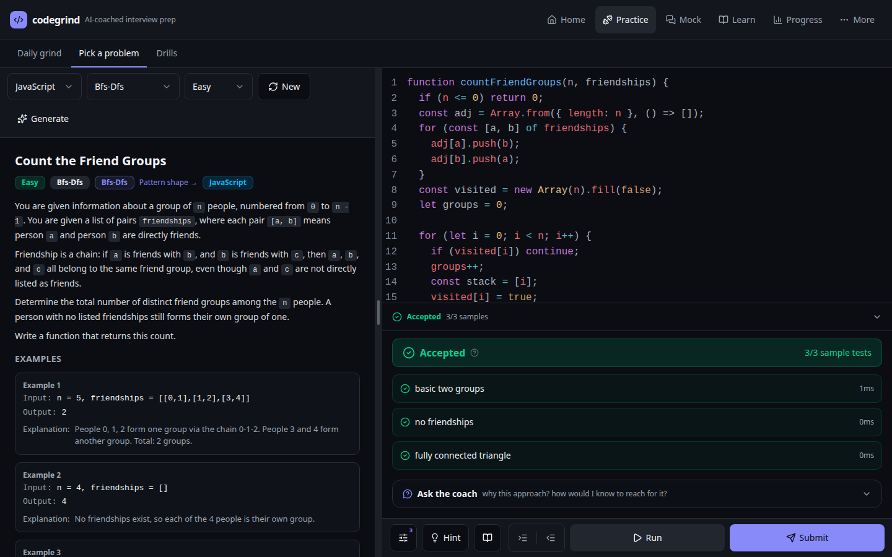
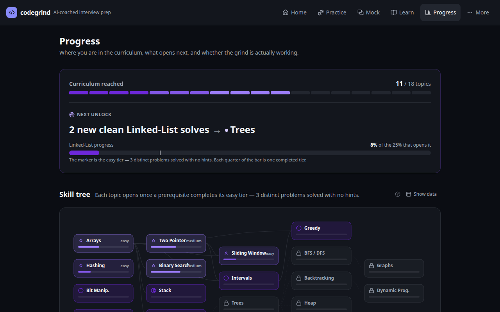
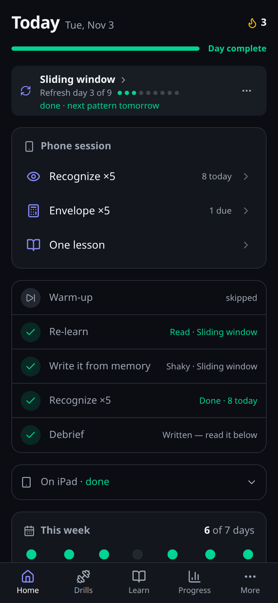
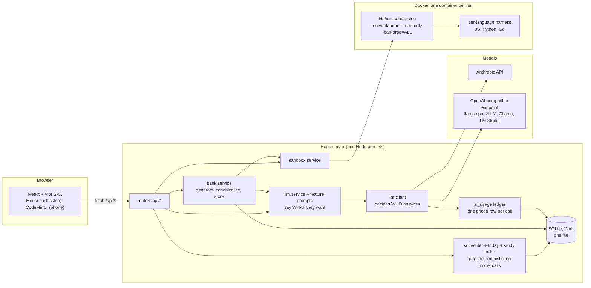
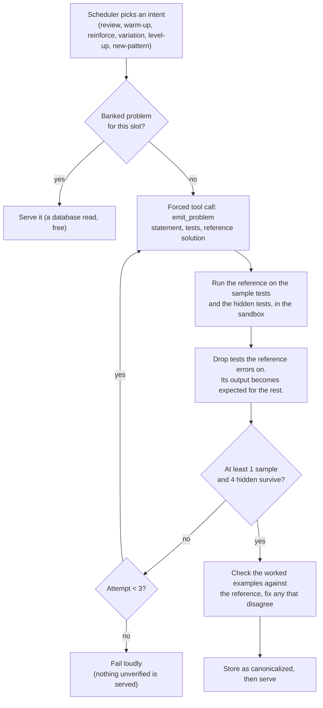

# codegrind

**A self-hosted interview-prep trainer that writes its own coding problems, proves each one is solvable before serving it, runs your code in a locked-down container, and coaches you on the pattern you missed.**

[](LICENSE)  



One user, one SQLite file, no accounts, no cloud services. Every model call is one you triggered, so an idle instance costs nothing. It runs against Claude, or against an OpenAI-compatible model you host yourself, in which case there is no API key anywhere in the system.

React · Hono · TypeScript · SQLite · Docker · JavaScript, Python and Go

---

## What it does

You open **Today** and get a guided session: clear the review pile, explain one system-design concept out loud, solve two adaptive coding problems, run one mock interview, then read a short debrief.

- **Coding problems are generated, verified, then banked.** The model writes a problem and a reference solution. The server runs that reference in the sandbox and uses its output as the expected answer for every test. A problem whose reference cannot pass its own tests is never stored.
- **Your code runs in a throwaway container** with no network, a read-only filesystem, no capabilities, and memory, PID, CPU and wall-clock caps.
- **The coach names the pattern, not the answer.** After a submit you get the pattern you should have recognised, how to spot it next time, your complexity next to the optimal, and one thing to fix.
- **It remembers you.** An 18-topic skill tree with real prerequisites, a tier ladder you climb only with distinct, hint-free solves, spaced repetition per topic, and a review queue that re-serves the exact problem you struggled with, days later, with the hint button gone.
- **Mock interviews in four formats:** system design, behavioral, live coding and project deep-dive. Each one is graded per stage, and every fact the interviewer had to hand you becomes a self-graded drill card on a spaced schedule.
- **Drills for the rest of the loop:** a no-code Recognize drill (read a statement, pick the pattern), back-of-the-envelope math reps, concept reps graded against hand-written rubrics, and a voice-first coach for drafting STAR stories.
- **Interview loops.** Enter a company's interview date and round types. Reviews are never scheduled past it, everything open is pulled due 1-2 days before, and the daily mock rotates toward the rounds you will face.

<table>
<tr>
<td width="68%"></td>
<td width="32%"></td>
</tr>
<tr>
<td><sub>Progress: the prerequisite skill tree, tiers and counters.</sub></td>
<td><sub>The phone layout: an installable PWA for the steps you can do away from a keyboard.</sub></td>
</tr>
</table>

---

## How it works



A fresh problem goes through this pipeline before anyone sees it:



---

## Engineering decisions

These are the choices that shape the system, with what each one costs.

### The model never decides what the right answer is

The most common failure when a model writes coding problems is a correct reference solution paired with hand-written expected values that disagree with it. A problem stored that way is unsolvable, and it fails in the one way a learner cannot diagnose: it looks exactly like their own mistake.

So expected values are never taken from the model. `canonicalize` (in `bank.service.ts`) runs the generated reference against every sample and hidden test in the real sandbox, drops any test the reference errors on, and adopts the reference's actual output as `expected` for the rest. If fewer than 1 sample or 4 hidden tests survive, the problem is discarded and regenerated, up to 3 attempts. The worked examples in the statement are then checked against the reference too, and rewritten if they disagree. Every stored problem is self-consistent by construction: its reference passes its own tests.

**Cost:** two extra sandbox runs per generation, so a fresh problem takes roughly 15-30 seconds on Claude instead of about 5. A banked problem is served instantly.

**When the sandbox itself is down,** retrying would only burn generation calls, so the languages part ways. JavaScript stores the problem flagged `canonicalized = 0`, which keeps it out of every future bank read. Every other language throws. Minting a problem whose expected values no real run can reproduce is worse than failing loudly. The same rule is why an unfinished language (Java has a registry entry but no harness) is offered nowhere: every language picker derives availability from whether `test-harness/<lang>/Dockerfile` exists.

### Sandbox isolation

Every run, yours and the ones the server does to verify its own problems, executes in a fresh container:

```
timeout -k 3 <limit> docker run --rm --network none --read-only --cap-drop=ALL \
  --security-opt no-new-privileges --memory=<cap> --cpus=1 --pids-limit=<cap> \
  --tmpfs /tmp -v <work dir>:/work:ro <runner image> ...
```

| | JavaScript | Python | Go |
|---|---|---|---|
| memory | 256 MB | 256 MB | 512 MB |
| PIDs | 128 | 128 | 256 |
| wall clock | 12 s | 12 s | 30 s |
| `/tmp` | noexec | noexec | exec (a compiler has to run its binary) |

There is no fallback that runs submitted code in the server process. An infinite loop is a non-event: the outer `timeout` kills the container and you get a `timeout` verdict. Go nests its own budgets (per test 2 s, suite 10 s, compile 10 s) strictly inside the container's, so a hang still reports "3 of 8 passed, then this one hung" instead of an opaque kill.

Three details that came from real failures:

- **One equality fixture for three hand-written comparators.** Each runner has its own `deepEqual` and serializer. `test-harness/conformance/equality-cases.json` pins NaN and infinity sentinels, `-0`, float tolerance and key order, and `bin/build-runner-image` deletes any image that disagrees with it instead of publishing it.
- **Orphan reaping by label, not image.** If the runner script is SIGKILLed, its container survives. `bin/reap-runners` runs on a 5-minute timer and filters on a `codegrind.runner` label, because Docker resolves `ancestor=<tag>` to an image ID at query time, and a rebuild would hide exactly the containers that need reaping.
- **Hidden expected values never reach the browser.** They are stripped from the response, not just from the UI, and re-attached server-side when you ask the tutor why a test failed.

**What this is not:** containers share the host kernel. This protects against your own runaway loops and a generated solution doing something silly, not against hostile code. Running it also requires Docker-group access, which is root-equivalent on the host. See [Security](#security).

### An idle instance costs nothing

No background jobs, no warming on a timer, no model call that you did not cause. The only timer in the deployment reaps orphaned containers and never touches a model.

The part that runs most often is free by design. The scheduler that picks every problem (`scheduler.service.ts`) imports no model client: it scores candidates from SQLite state and draws one with a seeded PRNG. The Today routine and the Study reading order are pure functions too. The one model call in the session path, a per-sitting plan, only nudges a score and falls back to a default if it fails.

| action | model calls |
|---|---|
| a banked problem | 0 (a database read) |
| Run against the sample tests | 0 |
| a fresh problem | 1 (up to 3 on retries), plus 2 sandbox runs |
| Submit | 1 coaching call |
| a question to the tutor | 1 |
| first-run seeding | 8 by default, 12 at most (a server-side ceiling) |

Every call passes through one choke point (`llm.client`) that writes a priced row to an `ai_usage` table, and the Today header shows spend for the day and the month. Automatic reviews (card grading, step reviews, the auto debrief) sit behind one "AI reviews" switch.

Calls are routed by role, not by feature. On Claude the defaults are Sonnet for generation and coaching, Haiku for short forced-tool checks (hints, plans, card grading), and Opus for the tutor chat, which is one call per question you actually ask. Of the 23 call sites, 22 are forced tool calls with a JSON Schema as the response contract; the tutor is the only prose call.

### Bring your own model, with no failover

`llm.service` and the feature prompts say what they want; `llm.client` is the only file that knows who answers. The OpenAI-compatible provider was added as one branch there, and no call site changed.

The setup wizard does not take an endpoint on trust. It lists what `GET /v1/models` advertises, then fires one real forced tool call at the chosen model and times it. A model that answers in prose instead of calling the tool is refused on the spot, usually with the fix named (for llama.cpp, starting it with `--jinja`), rather than failing later inside a 30-second generate. A deny list keeps a router from handing work to a model id you never want touched.

There is deliberately no failover. If a local endpoint is down, calls fail and name the endpoint and model; they never quietly become billed Claude calls. The tutor defaults to the workhorse's provider for the same reason, so a local install stays local.

### No cloud, one SQLite file

The whole state of the app is one SQLite file in WAL mode: problem bank, attempts, skill state, review queues, mocks, drill cards, lessons, settings and the spend ledger. There are no accounts and no external services beyond the model you point it at. Backups are `bin/backup-db` (an online SQLite backup, not `cp`), and migrations are versioned and run by `bin/migrate`.

The tradeoffs are accepted on purpose: it is single-user, it has no authentication of its own, and the database must live on a local filesystem (SQLite locking breaks on NFS and mergerfs).

### Language is a property of the problem, not the submission

A problem's expected values were produced by running its reference in one language, so its tests are bound to that language. `POST /api/run` and `POST /api/submit` carry only `{problemId, code}`; the server reads the language from the problem. Grading Python against JavaScript-derived answers is not unlikely, it is unrepresentable.

Skill state, tiers and the review queue fork per language and start cold, because a tier means three distinct hint-free solves at that difficulty and you have not done that in Go yet. Every language-partitioned database accessor takes `language` as a required leading parameter, so a missed call site is a compile error rather than a silent cross-language read.

### Progress you cannot game

A tier credit is one **distinct** problem solved with **zero** hints; three credits clear a tier (easy, medium, hard, expert). Credits are deduplicated by problem ID, which closed a real exploit where re-submitting a passing solution walked a topic up for free. This replaced a solve-rate score that, under daily use, collapsed to a coin flip.

"Show me the answer" is always available and never refused. The reveal is written to a ledger before the solution is returned, so the next submit counts as assisted whatever the client does, and that problem earns no tier credit.

---

## Quickstart

You need **Docker** (your account able to reach the daemon) and **Node 20 or 22**. Not Node 24: `better-sqlite3` is ABI-pinned and crashes under it, and `bin/setup` detects that and tells you what to run.

```bash
git clone https://github.com/Hexidecibel/codegrind.git
cd codegrind
bin/setup
```

There is no file to edit first. `bin/setup` checks Node, Docker and disk, writes `.env`, installs, builds, migrates, builds the three sandbox images, starts the server and prints the URL:

```
codegrind setup  /home/you/src/codegrind

  ✓ node v22.22.0
  ✓ docker 29.1.3
  ✓ disk 620 GB free on /var/lib/docker
  ✓ .env written (port 9416, data /home/you/src/codegrind/data)
  · installing dependencies (npm, a minute or two the first time)…
  ✓ dependencies installed
  · building the client (typecheck + bundle; Monaco makes this the slow part)…
  ✓ client built
  · preparing the database…
  ✓ database ready — schema v4, 0 problems, 0 attempts, 0 lessons, 0 settings
  ✓ runner images: javascript python go
  · starting the server…
  ✓ listening on http://localhost:9416

  → open http://localhost:9416 to finish setup
```

The first image build takes several minutes; the finished images are about 650 MB, and setup wants 3 GB free for build scratch. Re-running it skips everything unchanged.

The browser then asks **which model writes your problems** (an Anthropic key, checked against Anthropic and stored in the database, never in `.env`; or an OpenAI-compatible base URL, usually with no key), a language, and whether to stock the bank with 8 starter problems.

```bash
bin/setup --port 9500     # bind elsewhere (written to .env)
bin/setup --check         # preflight only, change nothing
bin/status                # health, bank size, sandbox images
bin/logs                  # tail the server log
bin/stop                  # stop the server
```

## Configuration

Nothing is required. The wizard covers model choice and Settings can change it later; the environment can pin any of it for a deploy, field by field. See [`.env.example`](.env.example) for the full list with explanations.

| variable | default | purpose |
|---|---|---|
| `PORT`, `HOST` | `9416`, `127.0.0.1` | where the server binds. Keep the loopback host. |
| `DATA_DIR` | `./data` | the SQLite file and sandbox scratch |
| `ANTHROPIC_MODEL` | `claude-sonnet-5` | workhorse model on Claude |
| `ANTHROPIC_CHAT_MODEL` | `claude-opus-5` | tutor model on Claude |
| `CODEGRIND_PROVIDER` | `anthropic` | or `openai-compatible` |
| `CODEGRIND_ENDPOINT`, `CODEGRIND_MODEL` | none | base URL including `/v1`, and the exact model id |
| `CODEGRIND_CHAT_PROVIDER`, `CODEGRIND_CHAT_MODEL` | match the workhorse | run the tutor somewhere else |
| `CODEGRIND_MODEL_DENY` | empty | comma-separated model ids never to call |
| `CODEGRIND_MAX_OUTPUT_TOKENS` | `8000` | output cap for a local endpoint (`0` removes it) |
| `CODEGRIND_RB_DIR` | empty | resume-builder's install dir, used for its `bin/backup` before story-forge writes. Unset skips the backup. |
| `VITE_STORY_CAPTURE_URL` | empty | build-time: URL of your resume-builder, linked from the behavioral grade report. Unset hides the link. |

## Testing

```bash
npx vitest run     # 1,773 tests in 108 files, about 8 seconds
npx tsc -b         # typecheck
bin/build          # typecheck, bundle and precompress into dist/
```

The suite is hermetic by rule: no live database, no network, no model calls, no Docker. That keeps it fast enough to run on every save, and it means it proves nothing about the sandbox images. Those have their own gates: `bin/build-runner-image --selftest` checks each runner against the shared equality fixture, and `bin/smoke-e2e`, `bin/smoke-python`, `bin/smoke-go` and `bin/smoke-isolation` exercise the real containers and the language partition. `bin/dry-run-generate` scores a model on one generation attempt, by the stage that failed, without storing anything.

## Project layout

```
src/
  client/          React app: pages, components, hooks (desktop, phone and PWA)
  server/
    routes/        Hono routes, one file per area (submit, session, today, mock, ...)
    services/      scheduler, bank, sandbox, LLM seam (llm.client + providers), db and migrations
  shared/          types and pure logic used by both sides (Today, envelope math, loops, ...)
test-harness/      one Docker runner per language, plus the shared equality fixture
bin/               setup, start/stop/status/logs, backups, migrations, smoke tests, model dry runs
deploy/            systemd units: the server and the 5-minute container reaper
docs/              how-it-works, architecture, operations, troubleshooting, adding a language
```

Read next:

- [docs/how-it-works.md](docs/how-it-works.md): the conceptual guide. Generation and verification, the scheduler, the sandbox, what a submit does, and what each step costs.
- [docs/architecture.md](docs/architecture.md): the code map. Request paths, the LLM seam, the data model, settings, the client.
- [docs/operations.md](docs/operations.md): every `bin/` script, backups, migrations, running as a service.
- [docs/troubleshooting.md](docs/troubleshooting.md): failure modes and fixes.
- [docs/adding-a-language.md](docs/adding-a-language.md): the contract for a fourth language, as a checklist.

## Security

**codegrind is single-user and has no authentication.** The API is open to whoever can reach it. `HOST` defaults to `127.0.0.1`; do not bind it to `0.0.0.0` or publish it without your own authentication in front. Because every browser on your machine is already on loopback, the server also refuses any request carrying a foreign `Origin` outright, rather than only withholding CORS headers.

Submitted code is contained as described above, but a container is not a VM. Running the server requires Docker-group membership, which is root-equivalent on the host; make that a deliberate decision.

## License

MIT. See [LICENSE](LICENSE).
